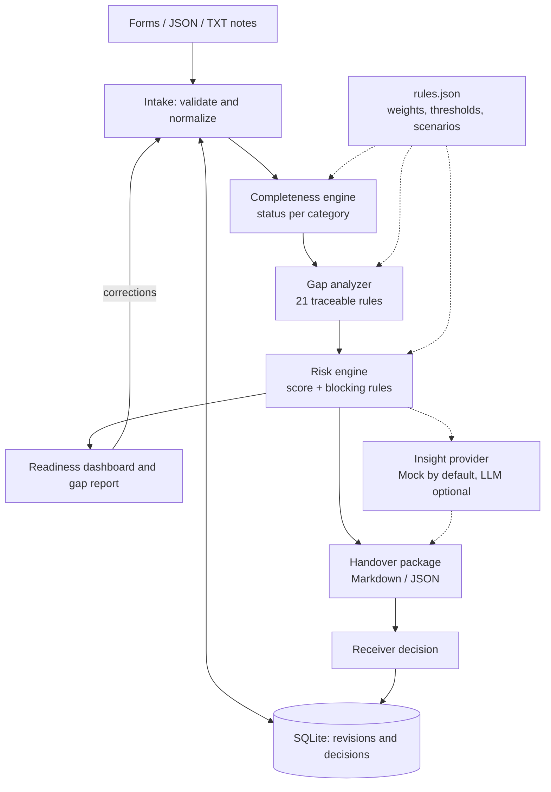
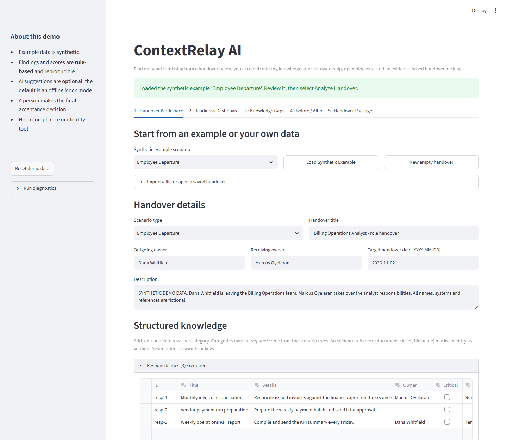
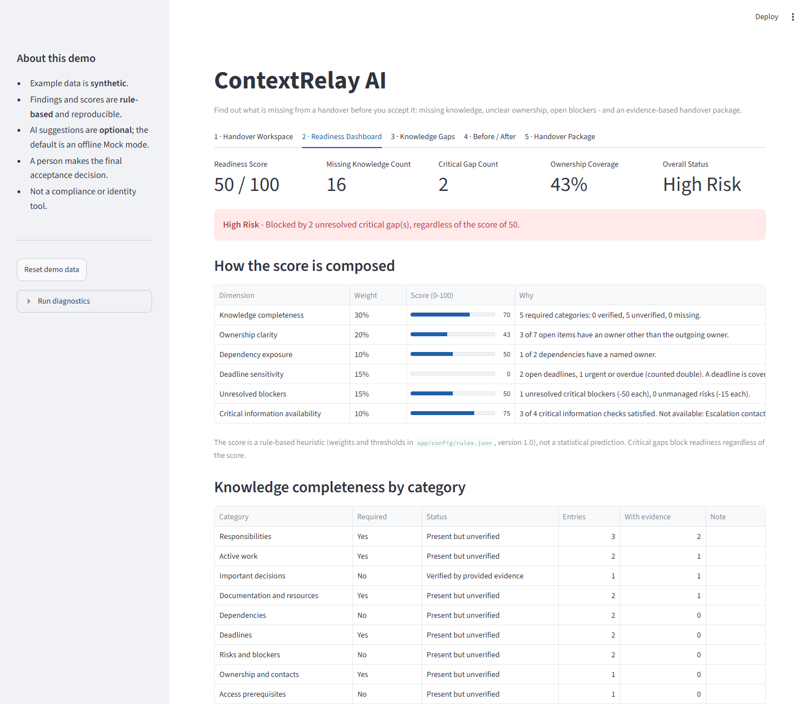
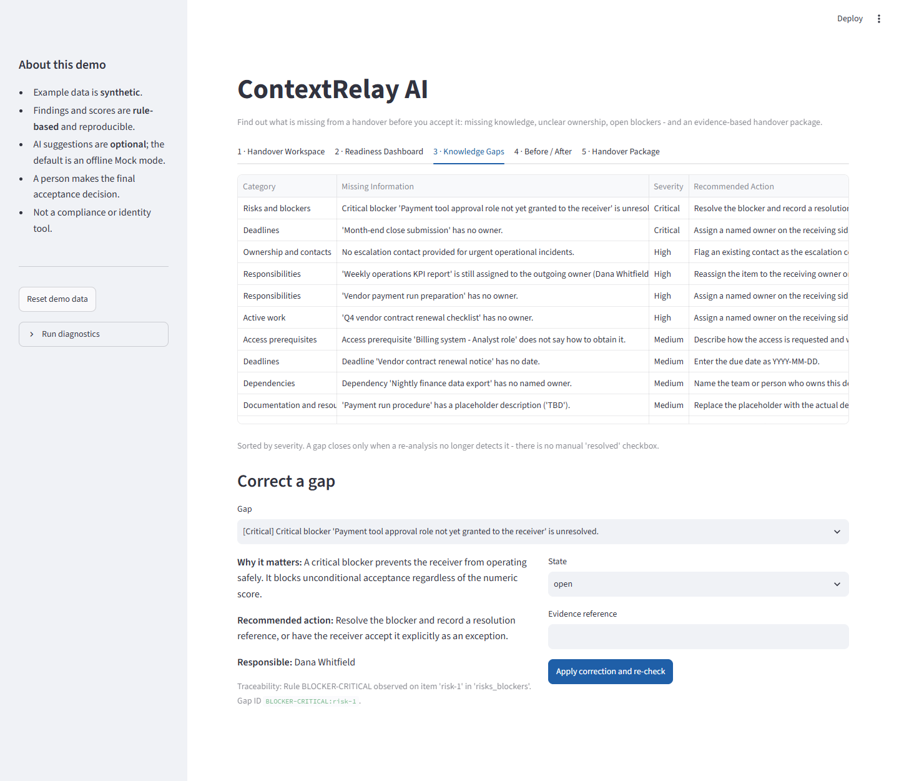
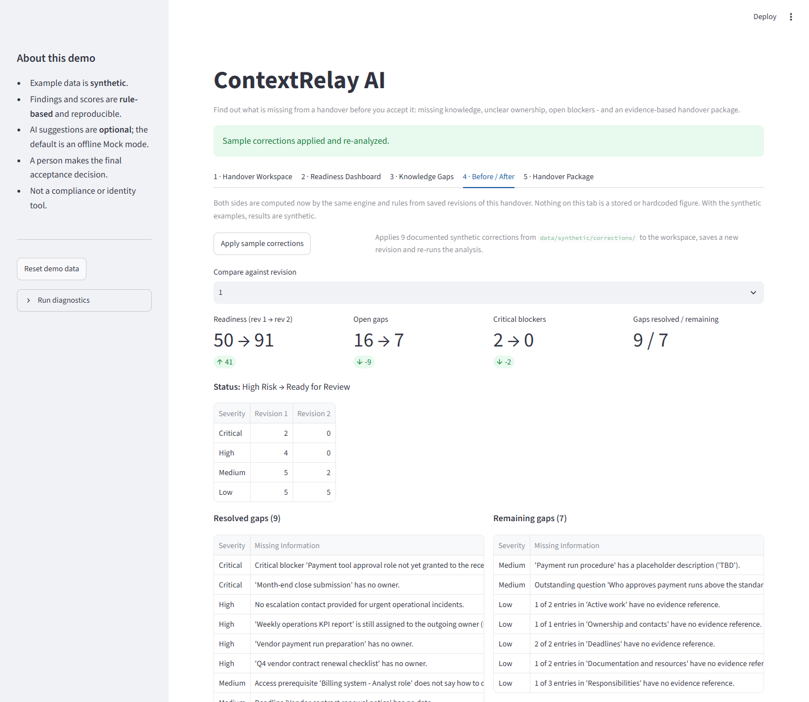
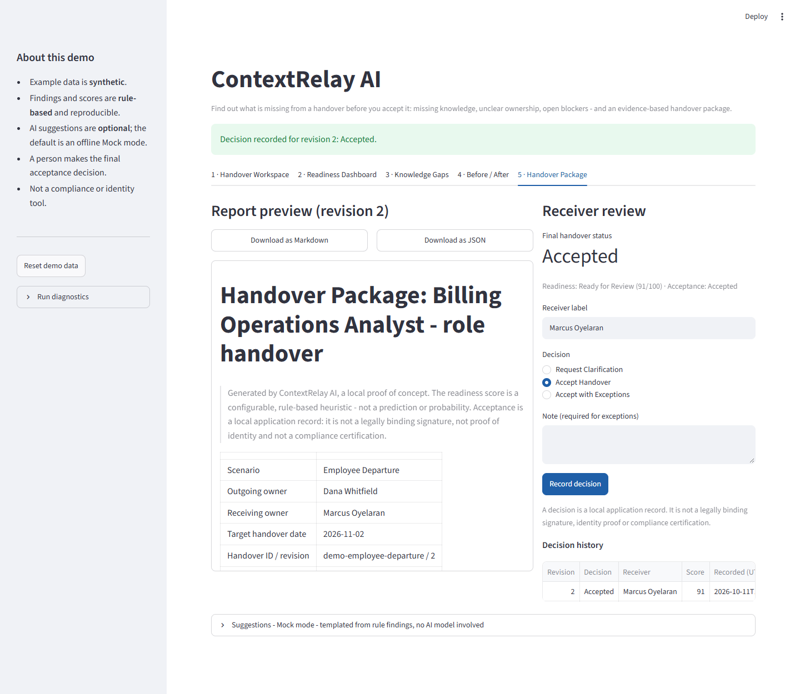

# ContextRelay AI

**Workplace knowledge transfer and continuity assurance — a lean, offline proof of concept.**

## What

ContextRelay AI checks a work handover *before* the receiver accepts it. You describe what is being handed over
(responsibilities, open work, deadlines, contacts, access, risks). The app tells you what is missing, how risky the
handover is, and what to fix — then produces a handover package the receiver can review and accept.

It runs entirely on your machine with deterministic rules and synthetic demo data. No API key, no cloud service and
no language model are needed.

## Why

Handovers usually fail quietly. A checklist confirms that "the documents were delivered", but nobody checks whether
the knowledge is actually there: who owns the weekly payment run now, who to call when it breaks, which deadline is
due three days after the colleague has left. The receiver finds out later, at the worst moment.

ContextRelay AI helps the receiver answer six questions before taking ownership:

1. What am I responsible for?
2. What is in progress?
3. What has already been decided?
4. What information is missing?
5. Which dependencies and blockers exist?
6. What must be clarified before I accept?

## How

1. **Enter or load a handover** — through forms, a JSON file, or plain-text notes.
2. **Analyze** — rules check each knowledge category against what the scenario requires.
3. **Review the gaps** — every gap has a severity, a reason, a recommended action and the rule that produced it.
4. **Correct and re-analyze** — a gap closes only when the data really satisfies the rule. There is no "mark as done" checkbox.
5. **Compare before and after** — both sides are recomputed from saved revisions by the same engine.
6. **Review and decide** — the receiver requests clarification, accepts, or accepts with explicit exceptions.
7. **Download the handover package** as Markdown or JSON.

Three handover scenarios are supported, each with its own required knowledge: **Employee Departure**,
**Freelancer Project Completion** and **Temporary Team Handover**.

## Key Features

- **Explainable readiness score (0–100)** built from six visible dimensions, with weights in one small config file.
- **Blocking rules on top of the score** — an unresolved critical gap means *High Risk*, whatever the number says.
- **Four knowledge states** per category: missing, present but unverified, verified by evidence, not applicable (reason required).
- **21 traceable gap rules** — missing owners, items still assigned to the person leaving, deadlines without dates, unanswered questions, missing escalation contacts, placeholders such as "TBD", and more.
- **Acceptance safeguards** — no unconditional acceptance with blocking gaps; a changed handover invalidates an earlier acceptance.
- **Revision history** in a local SQLite file, with integrity check on load.
- **Optional AI suggestions** with a fully offline Mock mode as the default.

## Architecture



One Streamlit container, one SQLite file, two runtime dependencies (`streamlit`, `pydantic`). Business logic lives in
`app/services` and has no Streamlit imports. Details: [docs/ARCHITECTURE.md](docs/ARCHITECTURE.md).

## Screenshots

Captured from the running Docker container with the Employee Departure example.

| Handover Workspace | Readiness Dashboard |
|---|---|
|  |  |

| Knowledge Gaps | Before / After |
|---|---|
|  |  |

**Handover Package and receiver decision**



## Quick Start

Requires Docker with Compose.

```bash
docker compose up --build        # start, then open http://localhost:8501
docker compose down              # stop (saved handovers are kept in a Docker volume)
docker compose down -v           # stop and delete the saved data
```

Without Docker (Python 3.12):

```bash
pip install -r requirements.txt
streamlit run app/main.py
```

## Demo

A two-minute walkthrough, reproducible every time ([docs/DEMO.md](docs/DEMO.md) has the full script):

1. Select **Load Synthetic Example** (Employee Departure), then **Analyze Handover**.
2. Open **Readiness Dashboard** and **Knowledge Gaps** to see what is missing and why.
3. Open **Before / After** and select **Apply sample corrections**.
4. Open **Handover Package**, choose **Accept Handover**, **Record decision**, and download the report.

Observed result (synthetic data, rules version 1.0):

| | Before (revision 1) | After (revision 2) |
|---|---|---|
| Readiness score | 50 | 91 |
| Readiness status | High Risk | Ready for Review |
| Open gaps | 16 | 7 |
| Critical blockers | 2 | 0 |
| Ownership coverage | 43% | 100% |

Nine gaps are resolved by nine corrections; seven remain on purpose (one open question, one placeholder, five
"no evidence reference" notes). These figures describe the synthetic example only. They are not a claim about
time saved or productivity in a real organisation.

## AI Usage

| Part | How it works |
|---|---|
| Classification, completeness, gaps, score, status, acceptance rules, report | **Deterministic rules.** Same input, same output. No model involved. |
| "Suggestions" section (summary and clarification questions) | **Mock mode by default.** Fixed templates filled only from the rule findings. Offline and repeatable. |
| Optional LLM suggestions | **Off by default.** Rephrases the findings into a summary and questions. Cannot change scores, gaps or acceptance. |

To try the optional LLM mode outside Docker: `pip install -r requirements-llm.txt`, set `CONTEXTRELAY_LLM_ENABLED=true`
and `ANTHROPIC_API_KEY`. Only the engine's gap findings are sent (which include entry titles), not descriptions or notes.
The reply is validated and size-limited; on any error the app shows the Mock output and says so.
**The LLM path was not exercised against the live API in this project** — only its fallback and validation logic are tested.

## Validation

Results from the last run in this repository (Python 3.12, also repeated in a clean `python:3.12-slim` container):

| Check | Result |
|---|---|
| Unit tests | 75 passed |
| Integration tests | 15 passed |
| End-to-end tests (service workflow + Streamlit UI via `AppTest`) | 7 passed |
| Dependency audit (`pip-audit` on `requirements.txt`) | No known vulnerabilities found |
| Docker | Image builds, container reports *healthy*, UI answers on port 8501, data survives container re-creation |
| Browser walkthrough of the container | Full demo flow and file-import rejections confirmed in a headless browser |

Run the tests yourself: `pip install -r requirements-dev.txt && python -m pytest`.
More detail: [docs/ASSURANCE.md](docs/ASSURANCE.md).

## Limitations

- A **proof of concept for one local user**: no login, no roles, no concurrent editing.
- Acceptance is a **local record**. It is not a signature, not identity proof and not a compliance certificate.
- "Verified" means an **evidence reference was provided**. The app does not open or check the referenced document.
- The score is a **configurable heuristic**, not a validated prediction.
- Text notes are classified with **simple keyword rules** and need human review.
- No PDF export, no CSV import, no integrations with ticketing, HR or document systems.

Full list: [docs/LIMITATIONS.md](docs/LIMITATIONS.md). Business rules: [docs/BUSINESS_WORKFLOW.md](docs/BUSINESS_WORKFLOW.md).
